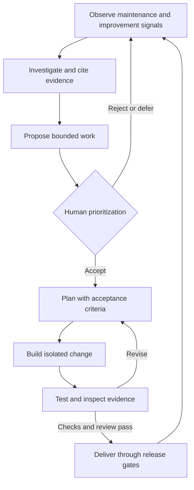
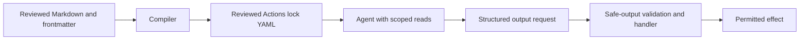
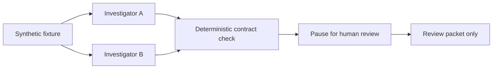

# Feedback loops and trust boundaries

Original conceptual diagrams; not product topology or a historical exclusivity claim.

## Continuous AI feeds the engineering inner loop

Outer loop: observe → investigate → propose → prioritize.
Inner loop: plan → build → test → deliver, including revision and human decisions.
Both existed as engineering concerns before AI; assistance changes possible speed
and delegation, not accountability. Continuous AI here is an operating pattern,
not a promise that every signal becomes a correct fix.

## GHAW artifact and authority boundaries

Repository policy and Actions controls surround execution. Required PR reviews,
merge checks and deployment environment approvals must actually be configured;
their presence is not inferred from the diagram.

## Local orchestration: fixed flow, uncertain findings

The existing local example does not apply or deploy a patch. Independent agents
can disagree or repeat the same error. A validated schema is not proof of truth.
Product references: [Dynamic workflows](https://docs.github.com/en/copilot/concepts/agents/dynamic-workflows),
[safe outputs](https://github.github.com/gh-aw/reference/safe-outputs/).
